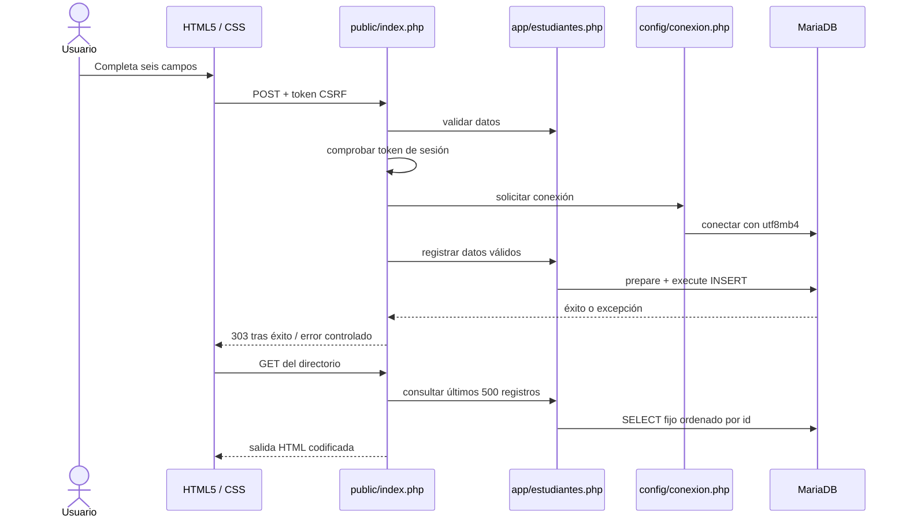

# Arquitectura y trazabilidad

El módulo usa separación modular: conexión en `config/`, reglas y acceso a datos en `app/`, controlador y vista en `public/index.php`. No se presenta como un MVC completo, ya que el controlador y la plantilla comparten archivo, alternativa modular admitida por el enunciado.

La conexión se abre antes de procesar la petición en la implementación. La validación y el token impiden invocar `registrar()` si la entrada no es aceptable. La consulta de lectura no contiene entradas de usuario y por ello usa `query()` con SQL constante. Si se incorporan filtros, deben agregarse parámetros en lugar de concatenar texto.

| Fase | Evidencia entregable |
|---|---|
| 1 | Investigación, DDL, tabla de ocho campos y captura en phpMyAdmin |
| 2 | Conexión PDO, formulario, consulta responsiva, seguridad y pruebas |
| 3 | Repositorio público, al menos cinco commits distintos, .gitignore y README |
| 4 | Informe PDF, capturas interpretadas y enlace público visible |

Se validan los límites en PHP; la base mantiene unicidad, obligatoriedad y restricciones CHECK. No se incluyen Update/Delete porque las instrucciones detalladas especifican únicamente Create y Read.
